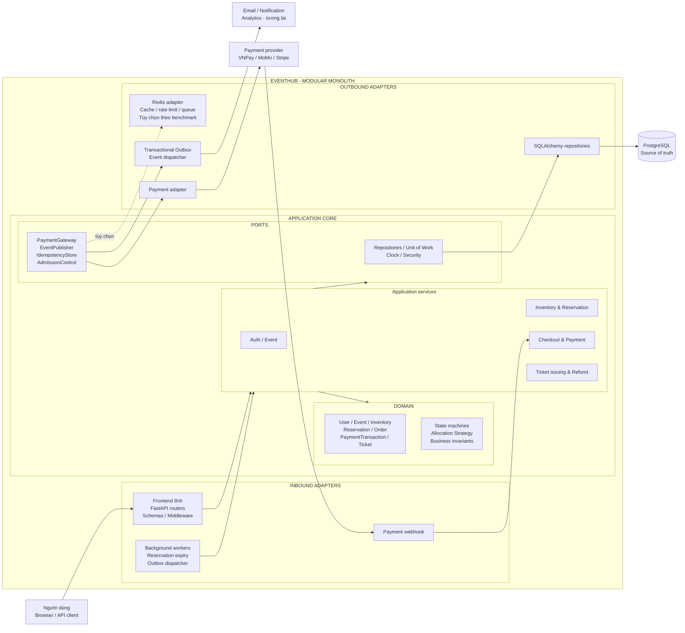

# Kiến trúc mục tiêu Pha 2

> **Trạng thái:** Kiến trúc đề xuất cho báo cáo tiến độ, chưa phải mô tả các chức năng đã triển
> khai. Pha 2 phát triển tiến hóa từ baseline Pha 1; không thay thế toàn bộ hệ thống và không mặc
> định chuyển sang microservices.

## 1. Kết luận kiến trúc

Kiến trúc Ports & Adapters của Pha 1 vẫn phù hợp và nên được giữ làm khung chính. Những điểm cần
cải tiến chủ yếu là **mở rộng mô hình nghiệp vụ và bổ sung adapter**, không phải đảo ngược chiều phụ
thuộc hoặc viết lại các tầng.

Kiến trúc mục tiêu là một **modular monolith theo Ports & Adapters**:

- PostgreSQL tiếp tục là nguồn dữ liệu chuẩn cho tồn kho, đơn hàng và thanh toán.
- Domain và application không import FastAPI, SQLAlchemy, Redis hay SDK thanh toán.
- Nghiệp vụ mới được thêm theo các module `inventory`, `reservation`, `payment` và `ticket`.
- Worker và webhook là các inbound adapter, dùng chung application service với HTTP API.
- Cổng thanh toán, Redis và message broker được che sau port; có thể thay thế adapter mà không sửa
  domain.
- Redis/Virtual Queue chỉ được thêm khi benchmark chứng minh cần thiết và không được dùng làm nguồn
  dữ liệu chuẩn của tồn kho.

## 2. Sơ đồ kiến trúc mục tiêu



### Cách đọc sơ đồ

Mọi luồng đi vào hệ thống qua inbound adapter rồi gọi application service. Application service điều
phối use case, nhưng quy tắc chuyển trạng thái và bất biến tồn kho nằm trong domain. Các thao tác ra
ngoài chỉ đi qua port. Vì vậy SDK thanh toán, SQLAlchemy, Redis hoặc cơ chế gửi thông báo có thể thay
đổi mà không làm domain phụ thuộc hạ tầng.

## 3. Phần giữ nguyên từ Pha 1

| Thành phần | Quyết định |
|---|---|
| Ports & Adapters | Giữ nguyên chiều phụ thuộc hướng vào domain/application |
| Repository + Unit of Work | Tiếp tục làm biên transaction cho mỗi use case |
| Data Mapper | Giữ domain model độc lập với ORM model |
| JWT + RBAC middleware | Giữ cơ chế xác thực tập trung; bổ sung policy khi có payment/webhook |
| PostgreSQL row lock | Giữ làm baseline đúng đắn cho tồn kho cho đến khi số đo chứng minh cần đổi |
| Background worker độc lập | Tái sử dụng mô hình vận hành, nhưng tạo worker riêng cho từng nghiệp vụ |
| Alembic + CI + concurrency test | Mọi thay đổi schema và cơ chế khóa phải đi qua quality gate hiện có |

## 4. Các module nghiệp vụ bổ sung

### 4.1. Inventory và Reservation

Module này tách khái niệm **giữ chỗ tạm thời** khỏi vé đã bán. Vòng đời mục tiêu:

```text
AVAILABLE ──reserve──> RESERVED ──payment succeeded──> BOOKED
                            ├──timeout──> EXPIRED ──> release inventory
                            └──cancel───> CANCELLED ─> release inventory
```

Các bất biến bắt buộc:

- Tồn kho không bao giờ âm và một ghế không thể thuộc hai reservation còn hiệu lực.
- Tạo reservation và trừ tồn kho phải thành công hoặc rollback cùng nhau.
- Mỗi reservation chỉ được hoàn tồn kho một lần.
- Chỉ reservation còn hiệu lực mới được xác nhận thanh toán.

### 4.2. Hai chiến lược phân bổ vé

Application service gọi một `TicketAllocationStrategy` thay vì chứa điều kiện cho mọi loại vé:

```text
TicketAllocationStrategy
├── GeneralAdmissionStrategy   - trừ bộ đếm số lượng nguyên tử
└── AssignedSeatStrategy       - khóa/đổi trạng thái từng seat cụ thể
```

Strategy Pattern cho phép thêm vé khu vực và vé ghế chỉ định mà không tạo một service booking chứa
nhiều nhánh `if/else`. PostgreSQL vẫn thực thi ràng buộc cuối cùng bằng transaction, conditional
update, unique constraint hoặc row lock phù hợp với từng chiến lược.

### 4.3. Order và Payment

`PaymentGateway` là outbound port. Adapter cụ thể chịu trách nhiệm chuyển DTO nội bộ sang request
của VNPay, MoMo hoặc Stripe. Domain không lưu object của SDK bên thứ ba.

Thanh toán dùng hai lớp chống xử lý lặp:

1. **Idempotency Key** cho request khởi tạo thanh toán từ client.
2. **Inbox/deduplication** cho webhook vì nhà cung cấp có thể gửi lại cùng một sự kiện.

Mọi lần thử thanh toán hoặc hoàn tiền được ghi thành `PaymentTransaction` append-only để đối soát.
Không cập nhật đè làm mất lịch sử giao dịch cũ.

### 4.4. Reservation Expiry Worker

Worker định kỳ lấy một batch reservation `PENDING` đã hết hạn bằng `FOR UPDATE SKIP LOCKED`, chuyển
chúng sang `EXPIRED` và hoàn tồn kho trong cùng transaction. Nhiều worker có thể chia batch mà không
xử lý trùng một reservation.

Worker này độc lập với `event completion worker` của Pha 1. Một worker hoàn tồn kho giữ chỗ; worker
còn lại chuyển trạng thái sự kiện đã kết thúc.

### 4.5. Transactional Outbox và Domain Event

Khi một transaction thay đổi trạng thái quan trọng, hệ thống ghi đồng thời một outbox record, ví dụ:

- `ReservationCreated`
- `ReservationExpired`
- `PaymentSucceeded`
- `PaymentFailed`
- `TicketIssued`
- `RefundRequested`

Outbox dispatcher gửi sự kiện sau khi transaction đã commit. Cơ chế này tránh tình trạng database
đã xác nhận vé nhưng thông báo hoặc tác vụ tiếp theo bị mất do tiến trình dừng giữa chừng.

Trong Pha 2, outbox có thể được xử lý ngay trong PostgreSQL. Chưa cần message broker nếu chưa có tải
hoặc consumer độc lập chứng minh nhu cầu.

## 5. Luồng xử lý quan trọng

### 5.1. Tạo reservation

```text
Client
  → Booking API
  → ReservationService
  → TicketAllocationStrategy
  → khóa/trừ inventory + tạo reservation PENDING + outbox event
  → COMMIT
  → trả reservation_id và expires_at
```

### 5.2. Xác nhận thanh toán từ webhook

```text
Payment Provider
  → Webhook Adapter
  → kiểm tra chữ ký + Inbox deduplication
  → PaymentService khóa order/reservation
  → nếu còn hiệu lực: PAID + BOOKED + TicketIssued
  → nếu đã hết hạn: ghi late payment + RefundRequested
  → COMMIT
```

Webhook là nguồn xác nhận cuối cùng; redirect từ trình duyệt chỉ phục vụ UX, không tự quyết định đơn
đã thanh toán.

### 5.3. Thu hồi reservation hết hạn

```text
Expiry Worker
  → lấy batch PENDING quá hạn bằng SKIP LOCKED
  → conditional transition PENDING → EXPIRED
  → hoàn đúng lượng tồn kho đã giữ
  → ghi outbox event
  → COMMIT
```

## 6. Mô hình dữ liệu mục tiêu

Tên bảng cuối cùng có thể được điều chỉnh khi thiết kế migration, nhưng trách nhiệm dữ liệu nên được
tách như sau:

| Bảng/aggregate | Vai trò |
|---|---|
| `events` | Thông tin sự kiện và vòng đời phát hành |
| `ticket_types` | Loại vé, giá, tổng quota và loại GA/assigned-seat |
| `seats` | Ghế cụ thể và trạng thái hiện tại nếu sự kiện có sơ đồ ghế |
| `reservations` | Lần giữ chỗ, chủ sở hữu, trạng thái và `expires_at` |
| `reservation_items` | Ticket type/seat/quantity thuộc reservation |
| `orders` | Tổng tiền và trạng thái checkout ở mức khách hàng |
| `payment_transactions` | Nhật ký bất biến cho payment/refund attempt |
| `tickets` | Vé đã phát hành, mã QR/token kiểm vé |
| `webhook_inbox` | Khóa deduplication sự kiện từ nhà cung cấp |
| `outbox_events` | Sự kiện chờ dispatcher phát đi |

Không bắt buộc tạo tất cả bảng trong một migration. Mỗi vertical slice chỉ thêm schema cần cho use
case đang triển khai và phải có đường nâng cấp/rollback rõ ràng.

## 7. Các design pattern sử dụng

| Pattern | Áp dụng | Mục đích |
|---|---|---|
| Ports & Adapters | Toàn hệ thống | Giữ nghiệp vụ độc lập framework và hạ tầng |
| Repository + Unit of Work | Transaction nghiệp vụ | Đồng bộ inventory, reservation, order và outbox |
| State Machine | Reservation/Order/Payment | Chặn chuyển trạng thái không hợp lệ |
| Strategy | GA và assigned seat | Thay đổi thuật toán phân bổ vé theo loại |
| Adapter / Anti-Corruption Layer | Payment provider | Không để mô hình/SDK bên thứ ba rò vào domain |
| Idempotency + Inbox | API payment và webhook | Chống xử lý/trừ tiền lặp |
| Transactional Outbox | Tác vụ hậu transaction | Không mất sự kiện sau commit |
| Process Manager | Reserve → Pay → Issue/Refund | Điều phối quy trình dài qua nhiều callback |
| Worker / Competing Consumers | Expiry và outbox | Xử lý nền theo batch, mở rộng nhiều worker an toàn |
| Cache-Aside | Danh mục sự kiện, nếu cần | Giảm tải đọc; không cache làm nguồn tồn kho chuẩn |
| Admission Control | Virtual Queue, nếu cần | Bảo vệ database khi mở bán đột biến |

## 8. Thành phần tùy chọn theo số đo

### 8.1. Cache

Chỉ cache dữ liệu đọc như danh mục/chi tiết sự kiện. Số vé trên giao diện có thể là gần đúng, nhưng
quyết định bán vé luôn kiểm tra PostgreSQL trong transaction.

### 8.2. Redis và Virtual Queue

Chỉ bổ sung khi S4 hoặc kịch bản flash-sale chứng minh số request đầu vào lớn hơn khả năng xử lý an
toàn của API/database. Redis khi đó có thể cung cấp:

- Rate limiting.
- Số thứ tự hàng chờ.
- Signed admission permit có TTL.
- Cache danh mục chia sẻ giữa nhiều worker.

Virtual Queue chỉ cấp quyền vào luồng đặt vé, không giữ vé và không bảo đảm mua thành công.

### 8.3. Async I/O và nhiều API worker

Chỉ chuyển sang `AsyncSession` hoặc tăng worker/pool sau khi CPU, threadpool và connection-pool
metrics xác định được nút thắt. Việc thay đổi này là cải tiến adapter/runtime; không làm thay đổi
quy tắc domain.

## 9. Lộ trình triển khai tiến hóa

| Giai đoạn | Phạm vi | Kết quả kiểm chứng |
|---|---|---|
| 2A — Hoàn thiện baseline | S1, S4, CPU/RSS, reset warm-up, chạy lặp | Xác định nút thắt thật |
| 2B — Reservation | PENDING/EXPIRED, `expires_at`, expiry worker | Không oversell; hoàn kho đúng một lần |
| 2C — Payment safety | Payment port, idempotency, webhook inbox, transaction log | Không xác nhận/trừ tiền lặp; xử lý late payment |
| 2D — Ticket allocation | GA + assigned-seat strategy, ticket issuing | Hai dạng vé dùng chung use case/API ổn định |
| 2E — Reliable side effects | Domain event + transactional outbox | Không mất notification/refund task sau commit |
| 2F — Scale có điều kiện | Cache/Redis/virtual queue/async theo benchmark | BEFORE/AFTER tốt hơn và vẫn giữ bất biến |

Mỗi giai đoạn là một vertical slice có migration, unit test, integration test và PostgreSQL
concurrency test riêng. Không triển khai đồng thời toàn bộ sơ đồ.

## 10. Thuộc tính chất lượng và tiêu chí bảo toàn

### Tính đúng đắn

- Không oversell và không âm tồn kho.
- Một seat không thể được bán cho hai order.
- Reservation hết hạn chỉ hoàn kho một lần.
- Webhook lặp không tạo vé hoặc giao dịch lặp.

### Độ tin cậy

- Lỗi giữa chừng phải rollback hoặc có bước bù rõ ràng.
- Outbox event được retry và consumer xử lý idempotent.
- Late payment được ghi nhận và chuyển sang quy trình refund, không bị bỏ mất.

### Hiệu năng

- Mọi kết luận cải thiện phải so sánh BEFORE/AFTER trên cùng dữ liệu và cấu hình.
- Virtual Queue và cache không được che giấu lỗi consistency.
- Giữ p95/error rate trong ngưỡng được chốt sau S4.

### Quan sát và vận hành

- Correlation ID xuyên suốt API, webhook, worker và outbox.
- Metrics tối thiểu: active reservations, expiry lag, payment webhook failure, outbox backlog,
  booking conflict và connection-pool wait.
- Log không chứa token, password, thông tin thẻ hoặc raw payment secret.

## 11. Những thay đổi kiến trúc không đề xuất trong Pha 2

- Không tách microservices chỉ để thể hiện khả năng mở rộng.
- Không dùng distributed lock thay thế transaction PostgreSQL khi chưa có số đo.
- Không đưa Kafka/service discovery vào trước khi có nhiều consumer hoặc nhu cầu vận hành thật.
- Không dùng Redis làm nguồn dữ liệu chuẩn của tồn kho vé.
- Không chuyển toàn hệ thống sang Event Sourcing hoặc CQRS nếu use case hiện tại chưa cần.

Các lựa chọn trên làm tăng eventual consistency, lỗi mạng và chi phí vận hành. Modular monolith giữ
được một transaction cho use case cốt lõi, phù hợp hơn với quy mô và mục tiêu đo lường của dự án.

## 12. Đoạn tóm tắt dùng trong báo cáo tiến độ

> Pha 2 không thay thế kiến trúc Pha 1 mà mở rộng kiến trúc Ports & Adapters theo hướng modular
> monolith. Các module Reservation, Payment và Ticket được bổ sung vào application core; cổng thanh
> toán, worker hết hạn và transactional outbox được triển khai dưới dạng adapter. PostgreSQL tiếp
> tục là nguồn dữ liệu chuẩn và Unit of Work bảo đảm tồn kho, giữ chỗ và đơn hàng nhất quán trong
> cùng transaction. Strategy Pattern hỗ trợ cả vé khu vực và vé ghế chỉ định; State Machine quản lý
> vòng đời giữ chỗ/thanh toán; Idempotency và Inbox ngăn xử lý webhook lặp. Redis, cache và Virtual
> Queue chỉ được đưa vào sau khi benchmark Pha 2 chứng minh nhu cầu, nhờ đó hệ thống có thể mở rộng
> mà không đánh đổi tính đúng đắn hoặc tạo độ phức tạp không cần thiết.
